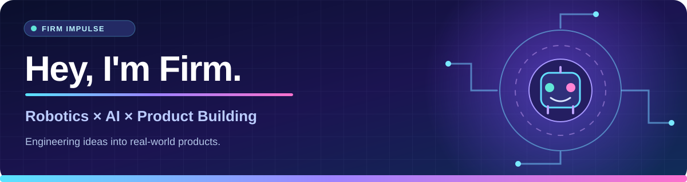

<!-- Firm Impulse profile · color showcase · 2026 -->

 

**Robotics & Automation Engineering @ KMUTT** &nbsp;·&nbsp; **Founder, Albert Innovation**

I build at the intersection of **computer vision, robotics, practical AI and human-centered products**.

 

## 👋 A little about me

- 🤖 **Engineering:** Studying Robotics & Automation at **King Mongkut's University of Technology Thonburi (KMUTT)**, Thailand.
- 🚀 **Entrepreneurship:** Leading **Albert Innovation**, exploring AI solutions for real-world problems.
- 👁️ **Applied AI:** Interested in computer vision for road safety, workplace safety and smart agriculture.
- 🎯 **Product mindset:** I enjoy going from a messy problem → a working prototype → a usable product.
- 🌱 **Learning by building:** I care about practical engineering, clear documentation and thoughtful UX.

## 🧰 When I build, I use

**Languages & frameworks**

 

**AI, systems & developer tools**

## 🌟 Featured projects

<table>
<tr>
<td width="50%" valign="top">

### 🗺️ [KMUTT OpenMap](https://github.com/Apichetfirm/KMUTT-OpenMap)

**Explore a campus in 3D.** An open-source, community-driven map of KMUTT Bangmod with building search and nearby places.

[🌍 **Try it live →**](https://apichetfirm.github.io/KMUTT-OpenMap/)

Independent student project; locations and routes are not all field-verified.

</td>
<td width="50%" valign="top">

### 🎞️ [PocketVideo](https://github.com/Apichetfirm/PocketVideo)

**Keep the moments, save the space.** Offline Windows app for compressing videos and photos, with Thai/English UI.

[💻 **View source & releases →**](https://github.com/Apichetfirm/PocketVideo)

Check Releases for the latest validated build; not all development features are released.

</td>
</tr>
<tr>
<td width="50%" valign="top">

### 🔬 [FRA271 Robotics Labs](https://github.com/Apichetfirm/FRA271-LAB1-B07-46-60-75)

**Explore the fundamentals.** Sensor experiments, ADC/encoder work, STM32 configurations and Simulink labs.

[⚙️ **Explore labs →**](https://github.com/Apichetfirm/FRA271-LAB1-B07-46-60-75)

</td>
<td width="50%" valign="top">

### 🧪 [Smart Farm Experiments](https://github.com/Apichetfirm/Smart-Farm)

**Sensors meet agriculture.** Early Arduino prototypes exploring ultrasonic distance measurement.

[🌱 **Explore the archive →**](https://github.com/Apichetfirm/Smart-Farm)

</td>
</tr>
</table>

## 📈 GitHub activity

Live third-party cards show publicly available statistics and may occasionally be unavailable. [View GitHub's native contribution graph →](https://github.com/Apichetfirm?tab=overview)

## 🤝 Let's build something meaningful

I'm interested in **applied AI, robotics, computer vision, product development and open-source collaboration**. Browse my projects, open a discussion in a relevant public repository, or follow my work here.

  

**Firm Impulse** ⚡ *Build thoughtfully · Test rigorously · Keep learning*

